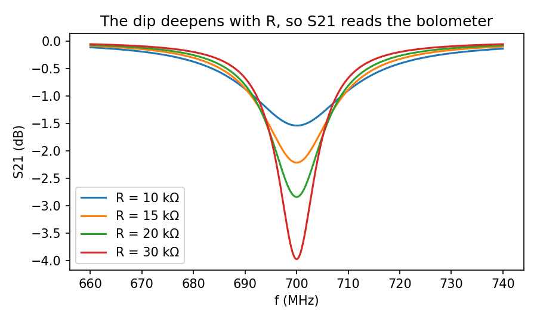
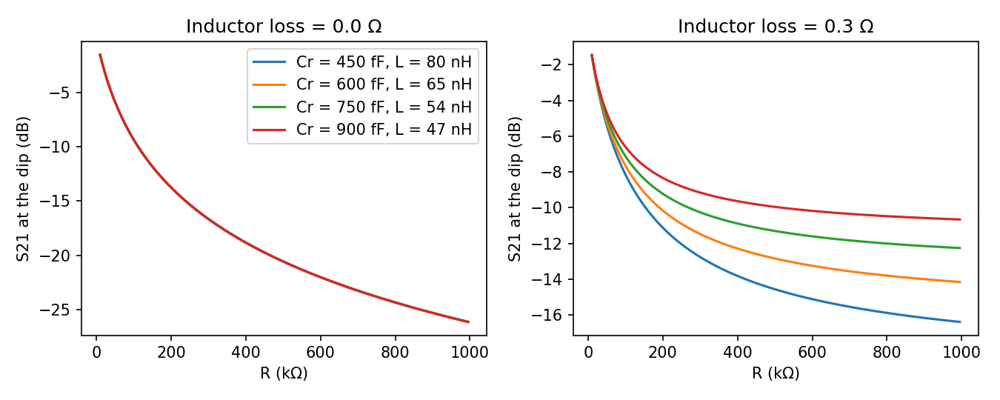
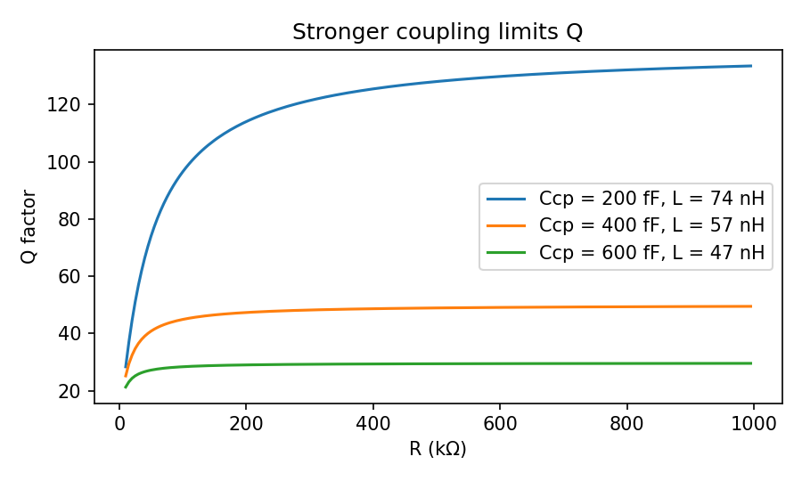
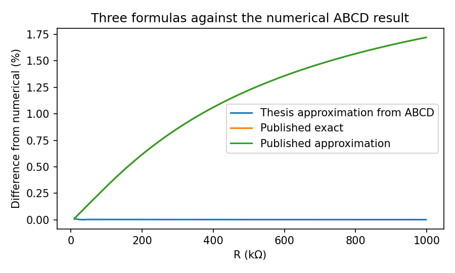

# RF readout circuit: a demonstration of my thesis method

This repo shows the method from my bachelor's thesis, *Optimizing the RF Readout Circuit for the Resistive Bolometers* (Aalto University, 2024, grade 5/5), which I did in the PICO group.

**This is a demonstration.** I wrote this Python code in 2026 for this repo. The Matlab code that I used in the group, the measured data and the details of the real circuits and samples are not here. The circuit values here are round examples, so the numbers below are not the results for a real device.

## The question

A resistive bolometer changes its resistance R when it absorbs microwave power. Single microwave photon bolometers could one day help to scale superconducting qubit readout. A resonator turns the change in R into a change in the transmitted signal S21. My question was: which circuit values make S21 respond most strongly to R?

## What I did in the thesis, and what this code shows

| Step | In the thesis | Here |
|---|---|---|
| 1. Model the circuit | Lumped elements in ABCD matrices, converted to S21 | `s21_single`, `s21_double` |
| 2. Keep the resonance fixed | To compare circuits fairly, each one must resonate at the same frequency. I found the inductance with a numerical search and analytically. | `l_search`, `l_exact`, `l_approx` |
| 3. Sweep the circuit values | S21 at resonance and the Q factor against R, for many capacitor and inductor pairs | `main` |
| 4. Check my result | I derived an approximation for a two-coupler circuit and compared it with the numerical result and with published formulas | `approx_abcd` |
| 5. Build it | I soldered 2 circuits with very different inductance and compared them with VNA measurements | Not in this repo |

## Results from this code

S21 shows R through the depth of the dip:



With a lossless inductor, all pairs of capacitor and inductor give the same curve at resonance. With a lossy inductor they separate, and the larger inductance responds more. The loss of the inductor can use up the response:



A larger coupling capacitance adds loss outside the resonator, so Q stops rising at a lower value:



The thesis approximation stays within 0.02% of the numerical two-coupler result here. The 2 formulas from Karimi and Pekola stay within 1.72%. The thesis found the same pattern, with all differences at about 2% or less:



## In the lab

The simulated S21 agreed closely with the VNA measurements of my 2 circuits. My noise measurement only showed the instrument noise of the VNA, so the effect of the circuit values on the noise stayed open. A complete optimisation needs that noise result.

## Run it

```bash
pip install -r requirements.txt
python3 readout_demo.py     # prints the formula check and saves figures/
python3 -m pytest           # 10 checks against hand results and the formulas
```

## Limits

- It uses a lumped circuit model at one target frequency, 700 MHz.
- It has no noise model.
- It does not model the parasitic capacitance of a real board.

## AI tools

I used AI tools to help build this code. I publish only code that I understand.
